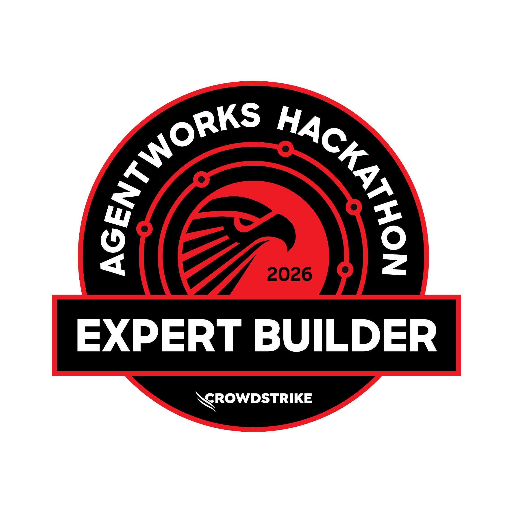
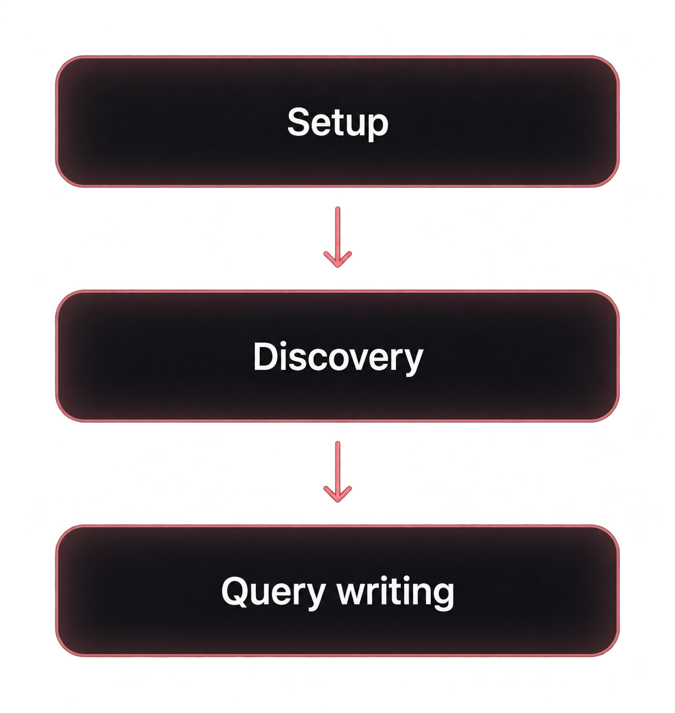

# CQLmatic

## Map your environment. Write CQL that fits your data.

CQLmatic helps your AI assistant write CrowdStrike Query Language using the sources, parsers, and fields in your own Next-Gen SIEM environment. Your assistant interprets the question. The local Rust CLI constructs and checks the query against a reusable environment map.

<a id="project-background"></a>

CQLmatic's query mechanics were refined through seven months of development as an internal CQL toolkit, using environment references to write tailored, functional queries. The design goal was perfect CQL: queries that use the right data and work as intended.

<p align="center">
  <a href="https://www.crowdstrike.com/en-us/blog/five-lessons-from-agentworks-hackathon/"></a>
</p>

The same engine powers the **"THIS IS CQL"** agent, where those mechanics were used to detect errors in queries generated by CrowdStrike's own tools.

CrowdStrike's [November 2, 2026 hackathon winners announcement](https://www.crowdstrike.com/en-us/blog/five-lessons-from-agentworks-hackathon/) recognized the agent as a notable runner-up in the AgentWorks Hackathon. Judges at [CrowdStrike and NVIDIA](https://www.crowdstrike.com/en-us/platform/charlotte-ai/agentworks-hackathon/) highlighted its reproducible tests and willingness to return inconclusive verdicts.

**CQLmatic v0.1.0 is the first public release. Testers and feedback are welcome.** Try it in your environment and share setup, discovery, and query-writing gaps using sanitized examples.

Version `0.1.1` adds native setup for Claude Code and GitHub Copilot surfaces. The published `0.1.0` downloads below do not contain those adapters yet; build `0.1.1` from source until its packages are published.

**[Try v0.1.0](#try-v010)** · [Read the setup guide](https://docs.cqlmatic.dev/setup/) · [Share sanitized feedback](#help-test-the-first-release) · [Technical details](#technical-details)

**Quick start:**

```sh
npx cqlmatic@0.1.0 setup
```

Use an assistant with local command access and an authorized CrowdStrike connection. Initial discovery can take substantial time and assistant tokens.

## Why CQLmatic

- **Map your sources and fields.** Bring parser context and measured field evidence into one reusable environment map.
- **Write CQL for your data.** Construct and check queries using the environment map you select.
- **Catch supported query traps.** Surface hazards around matching, missing fields, distinct counts, and grouping limits.
- **Reuse the map for investigations.** Inspect saved sources and fields offline whenever you or your assistant need context.
- **Find reference material offline.** Search bundled CQL guidance and CPS/ECS field references through the local catalog.

## How it works

<p align="center">
  
</p>

1. **Set up your connection.** Connect your local assistant to authorized CrowdStrike MCP and review the required permissions.
2. **Discover your environment.** Scout sources, review parser context, measure fields, and use status to see remaining gaps.
3. **Write with the saved map.** Your assistant consults the map and interprets the question. CQLmatic constructs and checks the query. Use your authorized client for live execution and result review.

## From intent to CQL

**A request to your assistant:**

> Over the past 90 days, which of our London and New York workstations ran PowerShell with ‘-enc’ and connected to at least five IPv4 addresses? Show me the busiest processes, their hosts, and the IPs they reached.

Your assistant turns the request into explicit source, field, matching, and aggregation choices for CQLmatic. The authorized execution client supplies the 90-day search window when running the query.

[View example input (JSON)](examples/powershell-network.plan.json) · [Read the query reference](docs/QUERY-REFERENCE.md)

## Help test the first release

Feedback is welcome on setup friction, missing or confusing discovery/status steps, and queries that the current coverage cannot express or check. Include your OS, assistant/client, workflow step, a synthetic reproduction, and expected versus actual behavior.

Use the [tester feedback form](https://github.com/mychaelconnolly/cqlmatic/issues/new?template=tester_feedback.yml). Submit sanitized or synthetic material only. Keep credentials, tenant identifiers, environment packs, parser definitions, raw search results, and receipts out of GitHub. Report sensitive findings through [the security policy](SECURITY.md).

## Technical details

### Try v0.1.0

Use the latest security patch on a supported Node.js release line: **22.x at 22.23.4 or later, 24.x at 24.22.1 or later, or 26.x at 26.12.1 or later**. These minimums include the [Node2Shell fix in Node.js's October security release](https://nodejs.org/en/blog/vulnerability/october-2026-security-releases). End-of-life lines are excluded.

Run these commands from outside the CQLmatic source checkout. Inside that checkout, npm can select the local, unbundled package; use your source-built executable there.

Run setup on demand:

```sh
npx cqlmatic@0.1.0 setup
npx cqlmatic@0.1.0 env inventory
npx cqlmatic@0.1.0 status
```

The npm package bundles the native CLI for **macOS Apple silicon and Linux x86_64**. It installs no global command and uses no install-time scripts or additional binary downloads. npm may ask before caching the package. Linux requires glibc 2.34 or newer and `libgcc_s.so.1`; Windows x86_64 uses the prebuilt ZIP below; other architectures use source builds. In the guides, replace the `cqlmatic` shorthand with `npx cqlmatic@0.1.0` when using this launcher. For strict stderr framing or supervised cancellation, use the native executable directly; see [input and output rules](USAGE.md#input-and-output-rules).

For the companion workflow, use an AI assistant that can run CQLmatic, access protected local files, and use an authorized CrowdStrike MCP connection. A web chat with only a remote MCP connection cannot run this binary. The `0.1.1` source build provides native setup adapters for **Codex, VS Code Local, Claude Code, and GitHub Copilot CLI/app/VS Code Copilot**; other capable agents have a tracked guided path. `copilot` on Windows and `gh copilot` launch the same Copilot CLI. See [the setup guide](docs/SETUP.md#native-hosts-and-effective-configuration) for each host's effective configuration and OAuth identity checks.

Your Falcon account needs the MCP and underlying data permissions for the searches you authorize. Full parser inventory also needs a **separate Falcon API client with NGSIEM Parsers: READ**. Setup, OAuth consent, allowlisting, and Falcon permissions are described in [the setup guide](docs/SETUP.md).

For **Windows x86_64**, use the prebuilt `cqlmatic-v0.1.0-windows-x86_64.zip` from [Release v0.1.0](https://github.com/mychaelconnolly/cqlmatic/releases/tag/v0.1.0). It contains `cqlmatic.exe`; Rust and C++ build tools are not required.

1. Download the ZIP and `SHA256SUMS` into the same folder. In PowerShell, change to that folder and compute the ZIP's hash:

   ```powershell
   Get-FileHash .\cqlmatic-v0.1.0-windows-x86_64.zip -Algorithm SHA256
   ```

2. Compare the hash with the ZIP's entry in `SHA256SUMS`. Continue only if they match. Extract into a new folder under your user profile:

   ```powershell
   Expand-Archive .\cqlmatic-v0.1.0-windows-x86_64.zip -DestinationPath "$env:LOCALAPPDATA\Programs\CQLmatic\v0.1.0"
   ```

3. Check the executable, then start setup:

   ```powershell
   & "$env:LOCALAPPDATA\Programs\CQLmatic\v0.1.0\cqlmatic-v0.1.0\cqlmatic.exe" --version
   & "$env:LOCALAPPDATA\Programs\CQLmatic\v0.1.0\cqlmatic-v0.1.0\cqlmatic.exe" --help
   & "$env:LOCALAPPDATA\Programs\CQLmatic\v0.1.0\cqlmatic-v0.1.0\cqlmatic.exe" setup
   ```

Administrator access and a global PATH change are unnecessary. See [Windows installation](docs/SETUP.md#install-on-windows) for the full procedure.

On Linux, run `chmod +x cqlmatic-linux-x86_64`, then `./cqlmatic-linux-x86_64 setup`. The guides use `cqlmatic` as shorthand for your executable path.

To build from source, clone the repository or extract the source release, install the pinned Rust toolchain, and run:

```sh
./dev build --release --locked
./target/release/cqlmatic --version
./target/release/cqlmatic setup
```

See [development](docs/DEVELOPMENT.md) for native Windows commands. Ask your assistant to follow [the companion workflow](docs/MCP-COMPANION.md), then run inventory and inspect `cqlmatic status` before writing environment-specific queries.

### Start with the environment

A field name in a reference guide does not tell you whether your data contains it, how your parser creates it, or which source to search. CQLmatic builds that context before you depend on it in a query:

1. Scout the telemetry visible to your account and confirm the sources you expect.
2. Inventory parsers, review their transformations, and confirm source/parser bindings.
3. Measure source and field populations, including parser-declared fields that event samples can miss.
4. Use `cqlmatic status` to see the evidence, review items, and remaining gaps.
5. Give your assistant that map to construct, check, execute, and refine queries for the question at hand.

Every installation starts with a **blank canvas**. Your map is built from your environment and saved locally for later queries. Parser declarations, observed fields, historical evidence, and unfinished work remain distinct. Discovery is limited to the confirmed target, permissions, time windows, and budgets; it cannot reveal telemetry outside your account's visibility.

### Write with the saved map

Status reports the active pack path. Select that pack explicitly when generating or checking:

```sh
cqlmatic generate --request examples/generate.request.json --pack .local/environment.pack.json --json
cqlmatic check --file .local/query.cql --pack .local/environment.pack.json --json
```

The map is also available independently of query generation. Analysts and agents with local CLI or file access can retrieve it whenever they need context for an investigation:

```sh
cqlmatic env inspect .local/environment.pack.json
cqlmatic env inspect .local/environment.pack.json --full
```

Use the path reported by `status`. Discovery does not automatically load the inventory into agent context or create persistent agent memory. Passing `--pack` supplies evidence to CQLmatic's checks; the agent reads the map separately. See [inventory access](docs/ENVIRONMENT.md#use-the-inventory-for-reasoning) for filtered inspection and snapshot limits.

Save the linked example locally, or run from the extracted source release so relative `examples/` paths exist. With `npx`, file paths still resolve from your current directory, not npm's cache. The bundled request is synthetic. Adapt its sources and fields to your map. Your assistant can turn broad intent into typed requests; direct English input follows a [bounded grammar](USAGE.md#bounded-english). The CLI makes no model calls and needs no model API key. Your chosen assistant has its own access and billing.

### Requirements, costs, and limits

Initial discovery is extensive. It uses multiple searches and may take substantial time. Agent orchestration, tool responses, and parser review can also consume significant model tokens. Review the [scope, limits, and cost guidance](docs/INVENTORY.md) before starting. Completed evidence is saved and reused.

Recipes, typed plans, and bounded English share one deterministic construction pipeline. Typed plans support joins and linked searches.

Bundled CQL guidance and CPS/ECS field references are also searchable offline through the [catalog](USAGE.md#look-up-syntax-and-fields).

Use `--require-observed` to require qualifying snapshot evidence for referenced deployment fields. Keep matching modes, missing-field choices, and exact versus estimated distinct counts explicit. Supported hazards include grouping ceilings even with `limit=max`.

`ready` means the implemented local checks and selected grounding policy passed. It does not establish full vendor-compiler coverage, execution completeness, or that a query answers the analyst's question. Execute the exact query through an authorized client and inspect the result when live confirmation is needed. The [coverage guide](docs/COVERAGE.md) lists supported constructs and gaps.

### Guides

- [Complete documentation](https://docs.cqlmatic.dev/): operator and agent reading paths, command/contract references, query authoring, assessment, and troubleshooting.
- [Setup and authentication](docs/SETUP.md): clients, CIMD, manual registration, permissions, and recovery.
- [Discovery and status](docs/INVENTORY.md): environment scope, parser review, measurements, cost, and refresh.
- [Application flow](docs/FLOW.md), [command reference](USAGE.md), and [environment API details](docs/ENVIRONMENT.md).
- [Analyst workflow](docs/ANALYST-WORKFLOW.md), [agent integration](docs/MCP-COMPANION.md), and [coverage and limits](docs/COVERAGE.md).
- [Query reference](docs/QUERY-REFERENCE.md), [machine contracts](docs/CONTRACTS.md), [result assessment](docs/RESULT-ASSESSMENT.md), and [troubleshooting](docs/TROUBLESHOOTING.md).

CQLmatic is licensed under [Apache-2.0](LICENSE). Third-party attribution is in [NOTICE](NOTICE). This independent project does not claim vendor endorsement.
